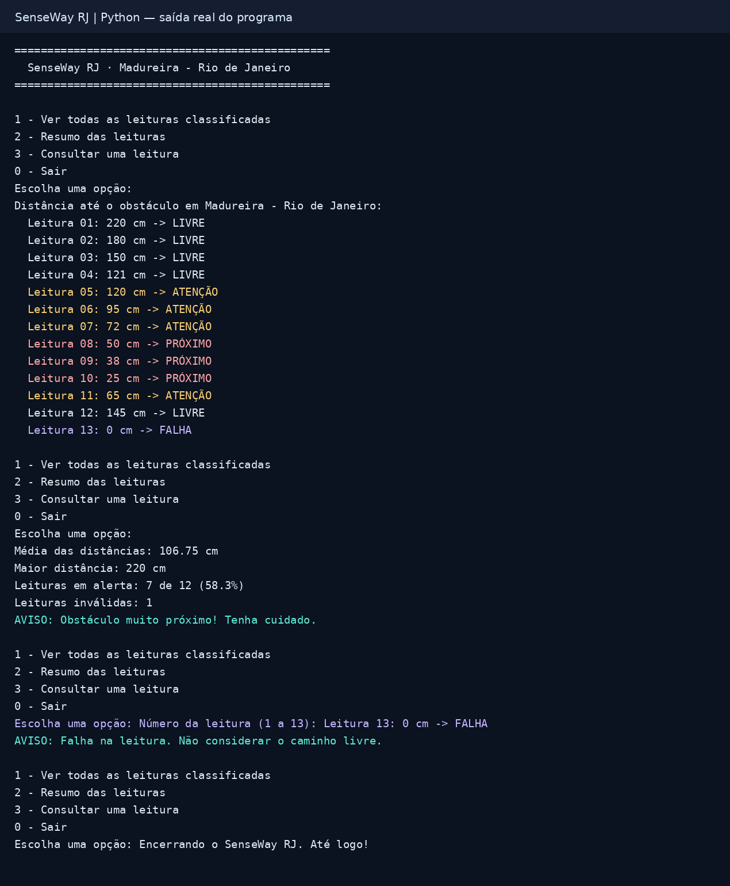

# SenseWay RJ

**Global Solution 2026 · FIAP · Computational Thinking with Python**

O SenseWay RJ é um protótipo acadêmico de tecnologia assistiva voltado à mobilidade de pessoas com deficiência visual. O projeto usa Madureira, no Rio de Janeiro, como contexto para explorar como uma pulseira poderia sinalizar obstáculos próximos.

## O que este programa demonstra

O programa simula 13 leituras de distância de um sensor de proximidade. Pelo menu, é possível listar as leituras classificadas, consultar uma leitura específica ou ver um resumo com a média, a maior distância, o percentual de leituras em alerta e a quantidade de falhas.

| Estado | Distância (cm) | Interpretação |
| --- | --- | --- |
| LIVRE | Acima de 120 até 400 | Nenhum obstáculo próximo detectado |
| ATENÇÃO | Acima de 50 até 120 | Obstáculo na faixa de alerta |
| PRÓXIMO | De 2 a 50 | Obstáculo muito próximo |
| FALHA | Abaixo de 2 ou acima de 400 | Leitura inválida |

Os dados e os limites são simulados para fins acadêmicos. O protótipo é demonstrativo e deve ser avaliado antes de qualquer uso em campo.

## Como executar

Com o **Python 3** instalado, abra um terminal na raiz do repositório e execute:

```bash
python python/main.py
```

Se o comando no seu sistema for `python3`, execute `python3 python/main.py`. No menu, digite `1` para listar as leituras, `2` para ver o resumo, `3` para consultar uma leitura ou `0` para sair.

## Arquivos da entrega

| Arquivo | Conteúdo |
| --- | --- |
| [`main.py`](python/main.py) | Programa com menu, classificação e resumo das leituras |
| [`README.md`](python/README.md) | Documentação técnica da disciplina |
| [`prompts.md`](python/prompts.md) | Registro dos prompts usados no projeto |
| [`registro_da_execucao.txt`](python/registro_da_execucao.txt) | Saída de uma sessão de teste no terminal |
| [`execucao.png`](python/execucao.png) | Captura da execução do programa |

## Demonstração

Na execução de exemplo, **7 das 12 leituras válidas ficaram em alerta (58,3%)**. A distância média foi **106,75 cm**, a maior foi **220 cm** e o programa registrou **uma falha**.



## Equipe

- Samuel Dantas Silva de Medeiros
- Felipe de Oliveira Corrêa
