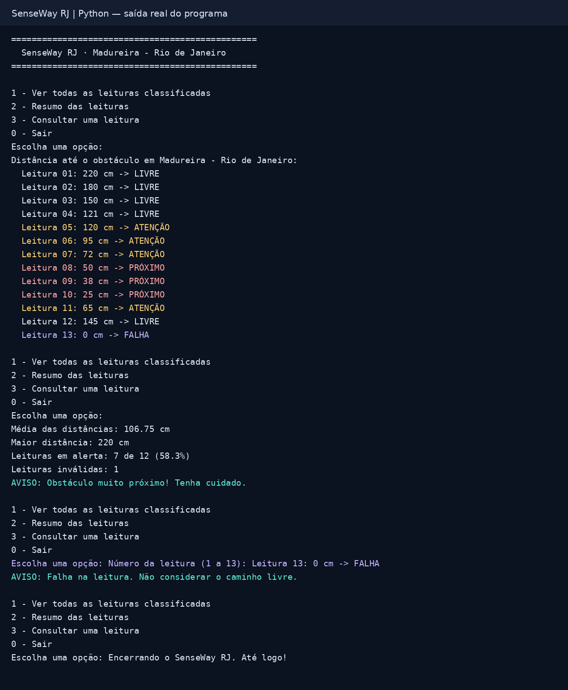

# Lógica · O Cérebro da CitizenTech

Parte de **Computational Thinking with Python** da CitizenTech **SenseWay RJ**, com foco em acessibilidade urbana em Madureira, Rio de Janeiro.

## O que o programa faz

O programa simula leituras de distância de um sensor de proximidade de uma pulseira assistiva. Ele classifica as leituras como LIVRE, ATENÇÃO, PRÓXIMO ou FALHA e mostra avisos simples. **Os dados são simulados; não são medições reais nas ruas de Madureira.**

## Como rodar

1. Instale o Python 3 (o mesmo usado nas aulas).
2. Abra a pasta `python/` no terminal ou no VS Code.
3. Rode:

```bash
python main.py
```

No Windows, se o Python estiver configurado com outro caminho, selecione o interpretador no VS Code e execute o `main.py`. Este programa **não precisa de `matplotlib`**.

## De onde vêm os dados

- **Grandeza medida:** distância de um obstáculo até o sensor, em centímetros (`cm`).
- **Quantidade de registros:** 13, sendo 12 válidos e um valor `0` simulando falha de leitura.
- **Origem:** dados **simulados para fins acadêmicos**. Não vieram de medições reais em Madureira.
- **Intervalo válido adotado:** de 2 a 400 cm para o protótipo ilustrativo.

## Faixas de decisão

Os limites abaixo também deverão ser usados no circuito da disciplina Edge e nas interações do site.

| Faixa | Condição | Aviso para o cidadão |
|---|---|---|
| LIVRE | `120 < distância <= 400` | Nenhum obstáculo próximo detectado pelo sensor. |
| ATENÇÃO | `50 < distância <= 120` | Atenção: obstáculo na faixa de alerta. |
| PRÓXIMO | `2 <= distância <= 50` | Obstáculo muito próximo! Tenha cuidado. |
| FALHA | `distância < 2` ou `distância > 400` | Falha na leitura. Não considerar o caminho livre. |

**Observação:** são faixas hipotéticas, usadas somente para demonstração. A pulseira não substitui bengala e não oferece garantia de segurança.

## Resumo calculado

A opção 2 mostra a **média** e a **maior distância** das leituras válidas, o **percentual em alerta** (ATENÇÃO + PRÓXIMO) e a quantidade de falhas. Valores inválidos não entram na média nem no percentual.

Para a lista de exemplo: média **106,75 cm**, maior distância **220 cm**, **7 de 12 leituras válidas em alerta (58,3%)** e **1 falha**.

## Integração com as outras partes

| Parte | Como conversa com o Python |
|---|---|
| Sensor · Edge | As leituras simulam as distâncias medidas por um sensor; as faixas de classificação devem ser as mesmas. |
| Experiência · STXD | Os avisos e opções do menu correspondem à jornada e aos requisitos do SenseWay RJ. |
| Interface · Front-end | A página explica os estados da pulseira e seu uso como protótipo acadêmico. |
| Interação · Web Dev | A regra de decisão será reproduzida em JavaScript no simulador do site. |
| Pitch · Storytelling | O programa pode ser mostrado em execução para demonstrar sua lógica. |

## Execução

A imagem abaixo reproduz a **saída capturada de uma execução real** do programa com entradas de teste (`1`, `2`, `3`, `13`, `0`).



## Equipe

- Samuel Dantas Silva de Medeiros — RM 576922
- Felipe de Oliveira Corrêa — RM 574803
- Turma: **1ESSRQ-2026**

## Antes de enviar

- [x] O programa roda do início ao fim, e o menu só termina no **0 - Sair**.
- [x] A lista tem 10 ou mais registros simulados do problema.
- [x] Cada registro é classificado com `if/elif/else`.
- [x] O resumo mostra média, maior valor e % de leituras em alerta.
- [x] Letra, número fora do menu e Enter vazio não derrubam o programa.
- [x] README preenchido com print de execução, e `prompts.md` atualizado.
- [ ] Confirmar que os limites e textos coincidem com o circuito Wokwi e o site, quando estiverem prontos.
- [ ] Cada integrante revisar e compreender o código antes da entrega.
- [ ] Publicar a pasta `python/` no GitHub e enviar o link no Teams.
